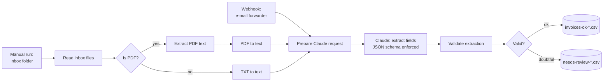

# invoice-ai-automation-n8n

An n8n workflow that reads supplier invoices (PDF or text), has an LLM (Claude) extract the key fields as strict JSON, **checks the result with plain rules**, and writes clean rows to a CSV file. Anything doubtful goes to a separate "needs review" list for a human.

## The problem

Small finance teams still type invoices into spreadsheets or ERP systems by hand: supplier, date, invoice number, net, VAT, total. It is slow, boring and error-prone, and an invoice whose total doesn't add up is easy to miss.

An LLM is good at reading invoices that all look different. But it can make mistakes, so this workflow never trusts it blindly: every extraction goes through a validation step, and only invoices that pass every check go into the output file automatically.

## How it works



| Step | What happens |
|------|--------------|
| **Trigger** | Manual run over every `*.txt` / `*.pdf` in the inbox folder, or a `POST /webhook/invoice` with `{"fileName", "text"}`, which an e-mail parser or forwarding rule can call. |
| **Text extraction** | `.txt` is decoded as UTF-8; PDFs go through n8n's *Extract From File* node. Scanned PDFs without a text layer are flagged, not guessed. |
| **LLM** | One call to the Claude Messages API. The response format is pinned with a **JSON schema** (`output_config.format`), so the model can only return the 11 expected fields. The prompt says to copy numbers *as printed* and not "fix" them, so the validation step can catch errors. |
| **Validation** | Plain JavaScript rules ([src/validate.js](src/validate.js)), no AI: required fields present, valid ISO date that isn't in the future, ISO currency code, numbers really are numbers, **total = net + VAT** (±0.02), VAT amount matches the VAT rate, known VAT rate, and the model's own confidence isn't `low`. |
| **Output** | Two CSV files per run, with a one-line summary per invoice, e.g. `EB-26-0231 \| Elektro Brandt GmbH & Co. KG \| 2026-02-19 \| 1656.04 EUR (net 1316.00 + VAT 250.04) \| REVIEW: total 1656.04 does not equal net 1316.00 + VAT 250.04 = 1566.04` |

## Run it locally

You need Docker and an [Anthropic API key](https://console.anthropic.com/).

```bash
git clone https://github.com/Marwan911e/invoice-ai-automation-n8n.git
cd invoice-ai-automation-n8n
docker compose up
```

Or without compose:

```bash
docker run -it --rm -p 5678:5678 \
  -e N8N_RESTRICT_FILE_ACCESS_TO=/files \
  -v n8n_data:/home/node/.n8n \
  -v "$PWD/sample-invoices:/files/inbox:ro" \
  -v "$PWD/output:/files/output" \
  docker.n8n.io/n8nio/n8n
```

Then:

1. Open http://localhost:5678 and create the owner account.
2. **Workflows → Import from file** → `workflow.json`.
3. Open the node **Claude: extract fields** → Credential → *Create new* → **Header Auth**:
   name `x-api-key`, value = your API key. Save it as "Anthropic API key".
4. Click **Execute workflow**. The five sample invoices are processed and the results appear in `./output/`.

To try the webhook, activate the workflow and send an invoice as text:

```bash
curl -X POST http://localhost:5678/webhook/invoice \
  -H "Content-Type: application/json" \
  -d "{\"fileName\": \"mail-123.txt\", \"text\": $(jq -Rs . < sample-invoices/invoice-002-cloudhafen-hosting.txt)}"
```

> On Linux, the container runs as user `node` (uid 1000). If n8n can't write to `./output`, run `sudo chown 1000:1000 output`.

## Example

**Input**: [sample-invoices/invoice-004-elektro-brandt.txt](sample-invoices/invoice-004-elektro-brandt.txt) (excerpt; this one has a wrong total on purpose):

```text
RECHNUNG EB-26-0231
Datum: 19.02.2026
...
Zwischensumme netto                                                1.316,00 €
Umsatzsteuer 19 %                                                    250,04 €
Endbetrag                                                          1.656,04 €
```

**Extracted JSON** (the shape the schema enforces):

```json
{
  "supplier_name": "Elektro Brandt GmbH & Co. KG",
  "supplier_vat_id": "DE000000044",
  "invoice_number": "EB-26-0231",
  "invoice_date": "2026-02-19",
  "currency": "EUR",
  "net_amount": 1316.0,
  "vat_rate": 19,
  "vat_amount": 250.04,
  "total_amount": 1656.04,
  "confidence": "medium",
  "notes": "Printed total 1656.04 does not equal net 1316.00 + VAT 250.04 = 1566.04."
}
```

**Output**: the four correct invoices end up in [output-example.csv](output-example.csv), and invoice 004 in [needs-review-example.csv](needs-review-example.csv):

| invoice_number | supplier_name | invoice_date | net | VAT | total | status |
|---|---|---|---:|---:|---:|---|
| RE-2026-00418 | Nordwind Bürobedarf GmbH | 2026-02-04 | 683.90 | 129.94 | 813.84 | ok |
| CH-2602-0153 | Cloudhafen Hosting UG (haftungsbeschränkt) | 2026-02-28 | 196.75 | 37.38 | 234.13 | ok |
| 2026-0087 | Grünwerk Catering e.K. | 2026-02-12 | 494.50 | 34.62 | 529.12 | ok |
| AL/2026/0412 | Alpenblick Logistik GmbH | 2026-03-03 | 484.80 | 0.00 | 484.80 | ok |
| EB-26-0231 | Elektro Brandt GmbH & Co. KG | 2026-02-19 | 1316.00 | 250.04 | 1656.04 | **needs_review**: total ≠ net + VAT (1566.04) |

The example CSVs were made with `npm run examples`, which runs the same validation code on the reference extractions in [test/fixtures/extractions.json](test/fixtures/extractions.json). The columns are the same ones the workflow writes.

## Project structure

```
workflow.json               the n8n workflow (import this)
sample-invoices/            5 fictitious invoices, one wrong on purpose
output-example.csv          example of the "ok" output
needs-review-example.csv    example of the "needs review" output
prompts/
  system-prompt.md          instructions for the model
  invoice-schema.json       JSON schema the API enforces on the answer
src/validate.js             validation rules (inlined into the n8n Code node)
test/validate.test.js       unit tests for the rules
scripts/build-workflow.js   builds workflow.json from prompts/ and src/
docker-compose.yml          local n8n with the right folders mounted
```

The prompt, the schema and the validation rules are normal files that can be tested and diffed, not text buried in a 1,000-line JSON export. After changing any of them:

```bash
npm test        # validation rules (Node 18+, no dependencies)
npm run build   # regenerate workflow.json
```

## License

MIT
